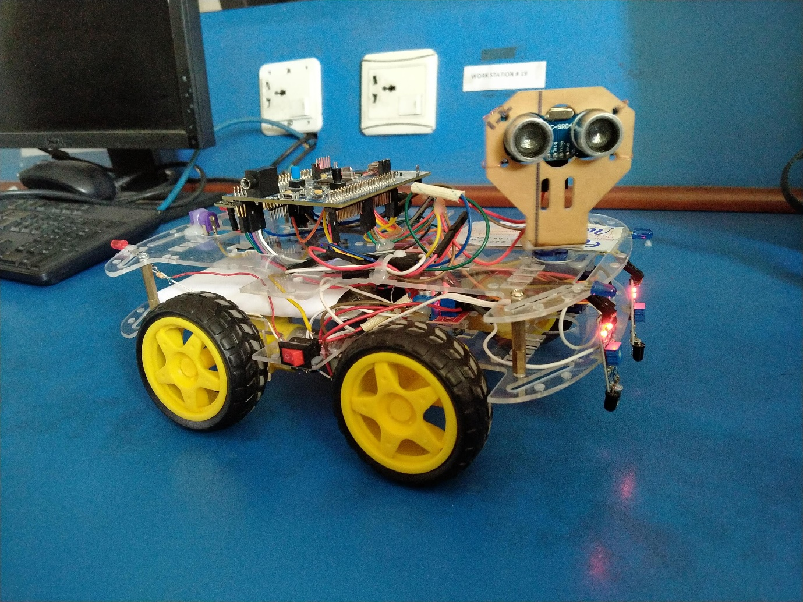
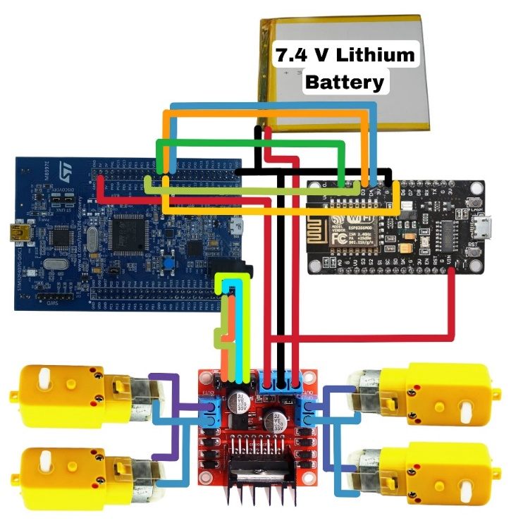
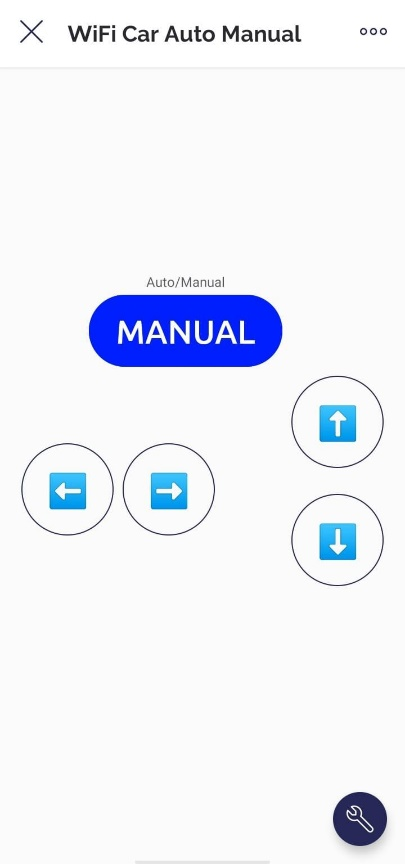

# STM32 Embedded Projects

Bare-metal Embedded C projects on the **STM32F407 Discovery** board, written in IAR Embedded Workbench.

## 1. Wireless obstacle-avoiding and line-following car  (`wireless-car/`)

- **Auto mode:** follows a line with two IR sensors; an HC-SR04 ultrasonic sensor on an SG90 servo sweeps 0–180° to find a clear path
- **Manual mode:** driven from a phone with the Blynk app through a NodeMCU (ESP8266), which passes commands to the STM32 over GPIO
- **Safety:** buzzer when an obstacle is closer than 10 cm; one button switches modes
- **Drive and power:** four geared DC motors on an L298N dual H-bridge, 7.4 V lithium battery
- Pin maps in `wireless-car/docs/`

| Wiring | Phone control |
|---|---|
|  |  |

## 2. Real-time clock on a 16×2 LCD  (`rtc-lcd-clock/`)

- DS1307 RTC over I2C, time and date on an HD44780 16×2 LCD with custom characters
- SysTick at 168 MHz for timing

## Build

IAR Embedded Workbench for ARM with the STM32F4 Standard Peripheral Library and the open-source STM32F4 libraries
by Tilen Majerle (`tm_stm32f4_*`, e.g. DS1307, HD44780, delay). The vendor libraries are not included; add them to build.

## Credits

Group lab projects (four members). This repository holds the application code.

## Licence

Copyright © 2025 Muhammad Asad Nadeem. All rights reserved.
The code is shared for viewing as part of my engineering portfolio. Please contact me before reusing it.
